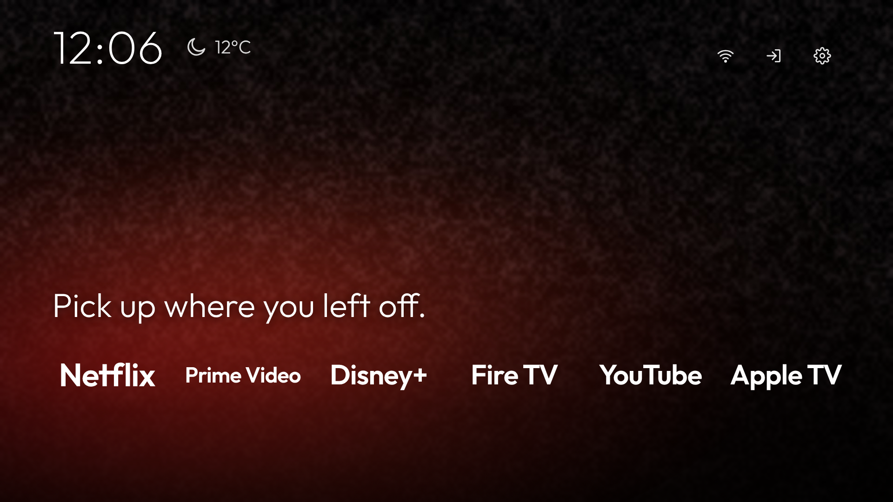
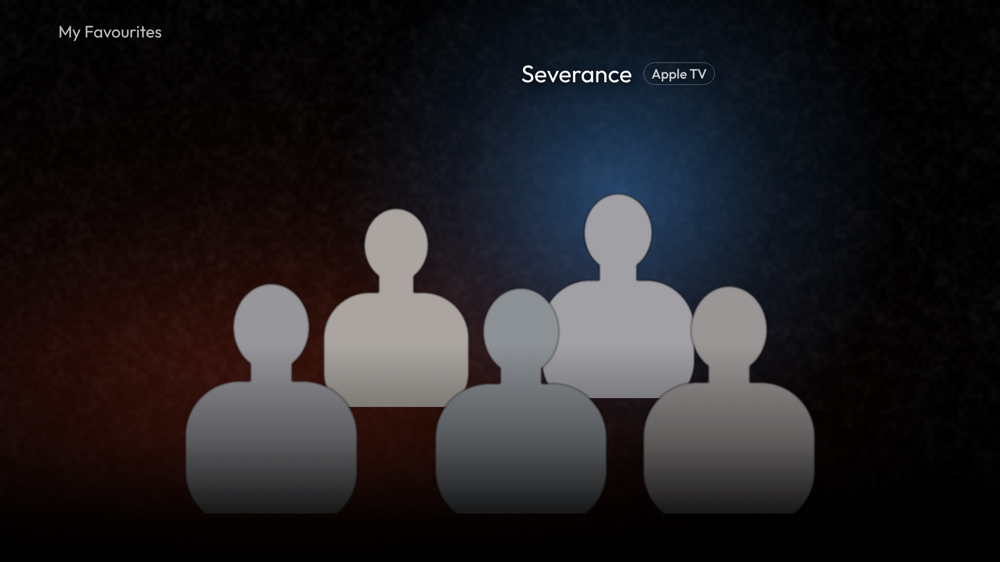
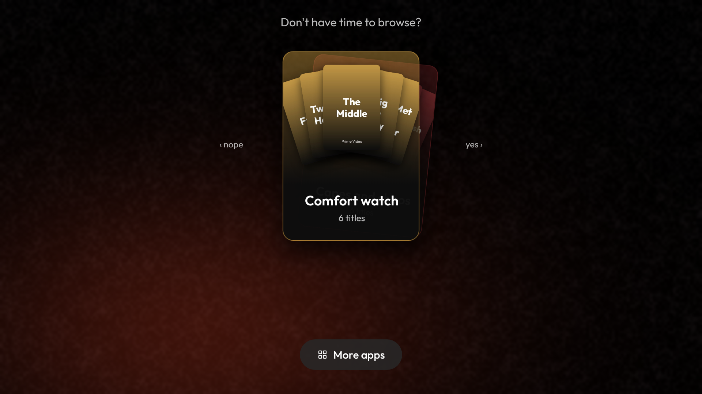
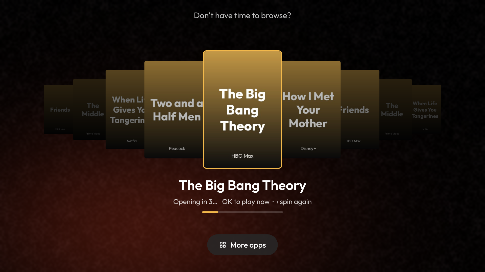

# TV Home for LG webOS

A clean, minimal home screen for LG webOS TVs. It runs as an app and is built in plain HTML, CSS and JavaScript, with no build step.



| My Favourites | Mood cards | Spin and play |
|:---:|:---:|:---:|
|  |  |  |

**What's inside**

- **Clock and weather:** Open-Meteo weather, with no account needed.
- **Top icons:** Wi-Fi, an Inputs menu (HDMI 1–4 and Live TV) and Settings.
- **Dock:** your streaming apps in one row. The selected app gets a soft glow and a short line of text.
- **My Favourites:** your favourite characters standing together like a poster. The selected one turns from black and white to colour, and OK opens their show.
- **Don't have time to browse?:** mood cards. Left means nope, Right means yes. The posters spin like a slot reel, land on one title and open it after 3 seconds.
- **More apps:** every other app, shown as icon tiles.
- **Shadow Chess:** a full 3D-perspective chess game against the TV, with 4 levels.
- **Background music:** plays your own song. The remote's Play/Pause button turns it on or off.
- **New in Tamil & Malayalam (optional):** a mood that refreshes itself every week.

Tested on an **LG OLED55BXPUA (webOS 5, 2020)**. It should work on webOS 5 and newer.

> 📘 **Full step-by-step guide (PDF):** [docs/TV-Home-LG-Guide.pdf](docs/TV-Home-LG-Guide.pdf)

---

## Quick start

You need a computer on the **same Wi-Fi as the TV**, plus **[Node.js](https://nodejs.org)**.

1. **Developer account.** Create a free account at **webostv.developer.lge.com**.
2. **Developer Mode app.** On the TV, install **Developer Mode** from the LG Content Store and sign in with that account.
3. **Turn it on.** Switch **Dev Mode Status** ON and let the TV restart. Open the app again and switch **Key Server** ON.
4. **Note two things.** Write down the **IP address** and **passphrase** the app shows.
5. **Install.** Download this repo, then run:

```bash
# macOS / Linux
./scripts/install.sh 192.168.1.20 ABC123

# Windows (PowerShell)
.\scripts\install.ps1 -TvIp 192.168.1.20 -Passphrase ABC123
```

TV Home opens on your TV.

**Already-built app:** the [Releases](../../releases) page has a ready-made `.ipk`. To install it yourself, run `ares-install --device lgtv <file>.ipk`.

## Make it yours

Almost everything lives in **`app/config.js`** and **`app/data.js`**.

| Change | How |
|---|---|
| Wallpaper | Replace `app/img/wallpaper.jpg` (1920×1080). |
| Dock apps and lines | `dock` in `config.js` |
| Weather units or location | `weather` in `config.js` |
| My Favourites | Put cut-outs in `app/img/cast/`. Run `python3 tools/make-cutout.py photo.jpg fav1` to make them from a photo. Then edit `shows` in `data.js`. |
| Mood cards and titles | `moods` in `config.js` and `titles` in `data.js`. A poster goes in `app/img/poster/<art>.jpg`. |
| Background music | Put your own song at `app/audio/bgm.mp3`. |
| Auto-updating Tamil & Malayalam mood | Set `freshFeed: true` in `config.js`. |

After any change, run `./scripts/update.sh` (or the install script again).

## Good to know

- **The Home button opens LG's own home screen.** LG doesn't let an app replace it. Two workarounds:
  - Move TV Home to the **first spot** in LG's app row, so Home → OK opens it.
  - Press and hold a **number key (1–8)** while TV Home is open to assign it to that key.
- **Developer Mode lasts 50 hours.** Open the Developer Mode app and press **Extend** now and then. If it runs out, the TV removes TV Home.
- **Streaming apps:** deep links open the title inside Netflix, Prime Video, Disney+, Hulu or Apple TV when the app supports it. Otherwise the app opens on its home page. Titles from apps that aren't installed are hidden.

## Credits and licence

- **Code:** MIT, see [LICENSE](LICENSE). The Outfit font is © The Outfit Project Authors and licensed under the SIL Open Font License; see `app/fonts/Outfit-OFL.txt`.
- **Inspiration:** a fan-made Android TV launcher called *TV Home*. See [CREDITS.md](CREDITS.md).
- **Not affiliated with LG, or with any streaming service or studio.** App and show names are used only to open those apps. This repo ships **no** studio artwork, logos or music: add your own for personal use.
